# 색 조합 시안

기본 화면(`styles.css`)의 색은 바꾸지 않았고, 각 시안은 `themes/` 폴더의 CSS가 색 기준값(토큰)만 덮어씁니다. 주소 끝에 `?theme=이름`을 붙이면 실제 앱이 그 색으로 열립니다. "샘플 데이터로 둘러보기"를 누르면 오늘·기록·계획 화면까지 볼 수 있습니다.

## 최종 후보 5개
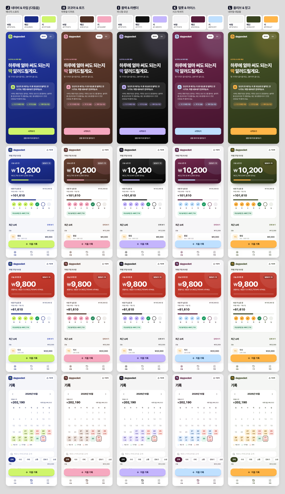

| | 이름 | 바탕 / 메인 / 키 | 컨셉 | 링크 |
|---|---|---|---|---|
| J | 네이비 & 라임 (다듬은 버전) | `#F5F6FA` / `#1A2B85` / `#CFF56B` | 에너지, 스포티 | https://smhan-dev.github.io/household-ledger-app/prototype/?theme=navylime |
| H | 코코아 & 로즈 | `#F7F6F5` / `#4E2F24` / `#F6A8BF` | 따뜻함, 디저트 | https://smhan-dev.github.io/household-ledger-app/prototype/?theme=cocoa |
| I | 블랙 & 라벤더 | `#F5F5F5` / `#111111` / `#C4B5FD` | 미니멀, 모던 | https://smhan-dev.github.io/household-ledger-app/prototype/?theme=monolav |
| K | 멀롯 & 아이스 (새로 만듦) | `#F7F6F8` / `#561B3A` / `#BFE0FF` | 시크, 럭셔리 | https://smhan-dev.github.io/household-ledger-app/prototype/?theme=merlot |
| L | 올리브 & 망고 (새로 만듦) | `#F5F6F4` / `#38431F` / `#FFB547` | 내추럴, 대담함 | https://smhan-dev.github.io/household-ledger-app/prototype/?theme=olive |

처음 버전 그대로는 https://smhan-dev.github.io/household-ledger-app/prototype/ 에서 볼 수 있습니다.

### J: 처음 버전에서 바꾼 것
네이비(`#1A2B85`)와 라임(`#CFF56B`) 값은 그대로 두고, 싸 보이던 효과만 걷어냈습니다.
1. 라임 버튼 아래의 라임색 빛 번짐을 네이비 그림자로 바꿨습니다.
2. 카드 오른쪽 위의 큰 라임 원을 없앴습니다.
3. 카드를 위에서 아래로 짙어지는 그라데이션으로 바꾸고, 카드 위쪽 가장자리에 얇은 라임 빛 선을 넣었습니다.
4. 바탕과 입력칸의 푸른 기를 조금 뺐습니다.

### 새로 만든 두 개
- **K. 멀롯 & 아이스**: 짙은 와인색 메인에 얼음 같은 하늘색 키. 따뜻한 메인과 차가운 키라는 반대 온도 조합이라 다섯 중 가장 고급스럽게 보입니다.
- **L. 올리브 & 망고**: 짙은 올리브 메인에 선명한 망고색 키. 다섯 중 키가 가장 진하고 쨍해서, 화면에서 버튼이 가장 먼저 눈에 들어옵니다.

### 겹치지 않는지 잰 방법
색을 사람 눈에 가까운 OKLCH 방식으로 바꿔서 색상 각도(빨강 0°, 노랑 약 90°, 초록 약 140°, 파랑 약 260°)를 비교했습니다. 10° 안쪽이면 같은 색으로 보입니다.
- **키 색**: 로즈 0°, 망고 73°, 라임 123°, 아이스 247°, 라벤더 294°. 가장 가까운 쌍은 아이스와 라벤더로 47° 떨어져 있습니다.
- **메인 색**: 멀롯 351°, 코코아 40°, 올리브 123°, 네이비 268°, 검정(무채색). 가장 가까운 쌍은 멀롯과 코코아로 49° 떨어져 있습니다.
- **컨셉**: 에너지(J), 따뜻함(H), 미니멀(I), 시크(K), 내추럴(L)로 서로 다른 자리를 맡습니다.

### 주의점
- **K**: 와인색은 빨강 계열이라 평소 카드가 "초과"처럼 보일 수 있습니다. 초과 카드는 훨씬 밝은 빨강이라 바뀌는 것은 분명히 보이지만, 실제 폰에서 느낌을 확인해 보는 게 좋습니다.
- **L**: 올리브 메인(123°)이 J의 라임 키(123°)와 색상 각도가 같습니다. 올리브는 어둡고 탁하고 라임은 밝고 쨍해서 다르게 보이지만, J와 L을 함께 쓰면 같은 계열이 두 번 나옵니다. 망고는 초과 빨강과 44° 떨어져 있고 훨씬 밝아서 경고색으로 읽히지는 않습니다.
- **H**: 로즈가 초과 빨강과 가까워서, 달력의 "예산 안" 날짜는 분홍 대신 코코아 빛으로 칠했습니다.

## 모든 시안에 공통으로 바꾼 것: 초과 카드 색
대비를 다시 재 보니, 시안마다 조금씩 달랐던 초과 카드의 빨강 위에서 작은 흰 글자의 대비가 2.6~2.9:1밖에 안 됐습니다(기준 4.5:1). 그래서 기본 화면을 포함한 모든 시안의 초과 카드를 같은 빨강(`#C93E31` → `#B53124`)으로 통일하고, 그 위 보조 글자를 더 진하게 했습니다.

| 초과 카드 위 | 대비 |
|---|---|
| 큰 숫자 | 5.0 |
| 보조 글자 | 4.6 |
| D-day 배지 | 5.9 |

## 글자 대비 (4.5:1 이상이면 작은 글자도 읽기 충분)
| | 메인 위 흰 글자 | 메인 위 키 색 | 키 버튼 위 글자 | 바탕 위 캡션 | 바탕 위 링크 | 흰 바탕 위 초과 |
|---|---|---|---|---|---|---|
| J | 12.2 | 9.8 | 12.7 | 4.9 | 7.2 | 5.3 |
| H | 12.0 | 6.4 | 8.8 | 5.9 | 6.8 | 6.1 |
| I | 18.9 | 10.2 | 8.9 | 5.3 | 10.4 | 5.3 |
| K | 13.0 | 9.5 | 10.6 | 6.0 | 7.0 | 5.5 |
| L | 10.5 | 6.0 | 8.3 | 5.5 | 5.8 | 5.6 |

L의 D-day 배지는 처음에 4.1이었습니다. 배지 바탕을 살짝 어둡게 바꿔서 9.8이 됐습니다.

## 최종 후보 화면별 캡처
| | 첫 화면 | 오늘 | 예산 초과 | 기록 |
|---|---|---|---|---|
| J | 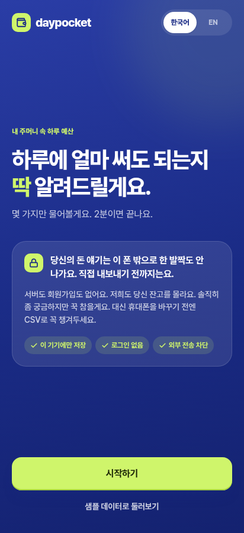 | 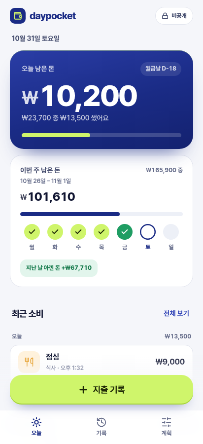 | 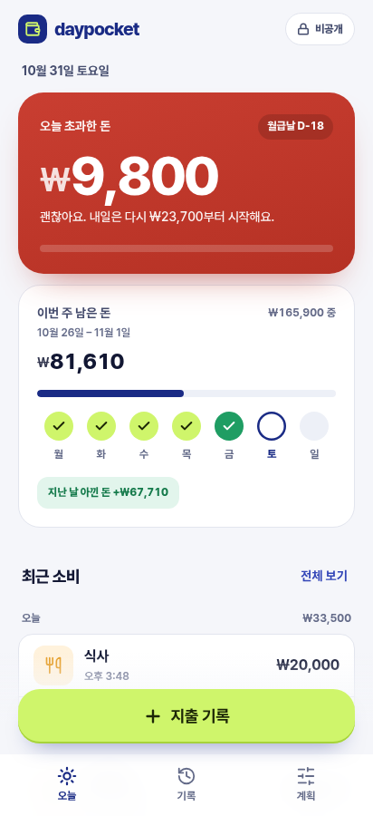 | 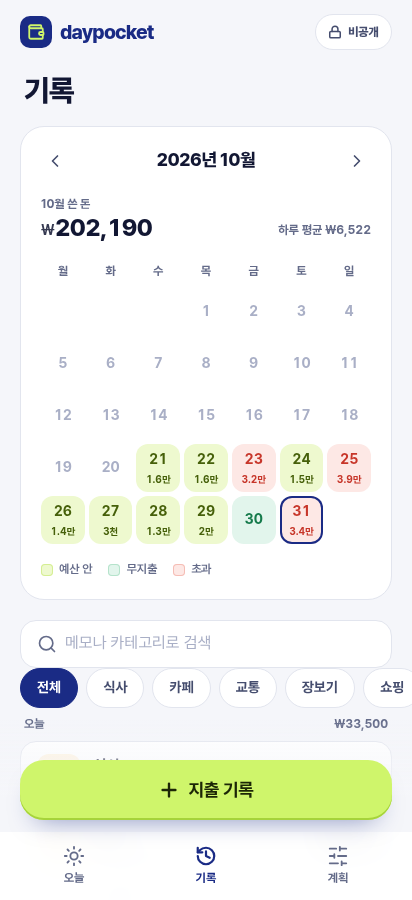 |
| H | 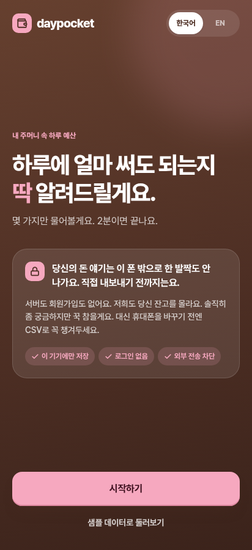 | 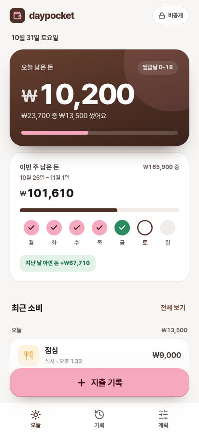 | 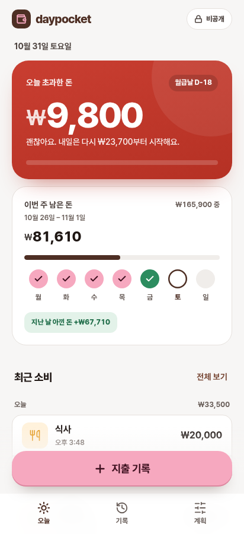 | 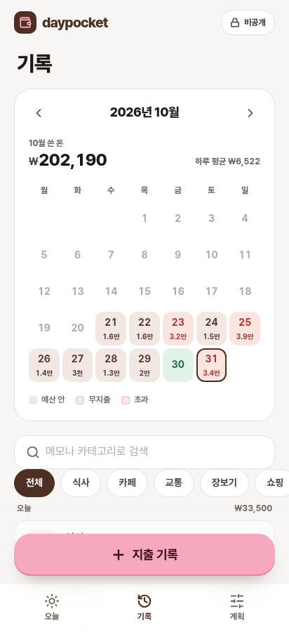 |
| I | 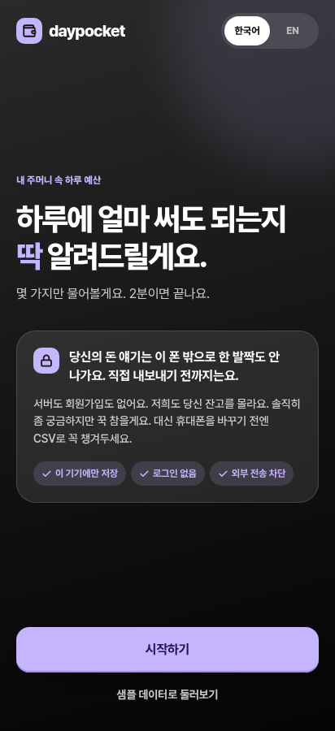 | 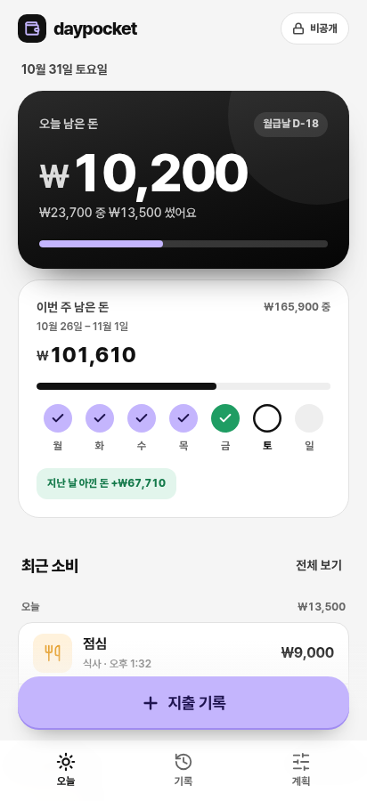 | 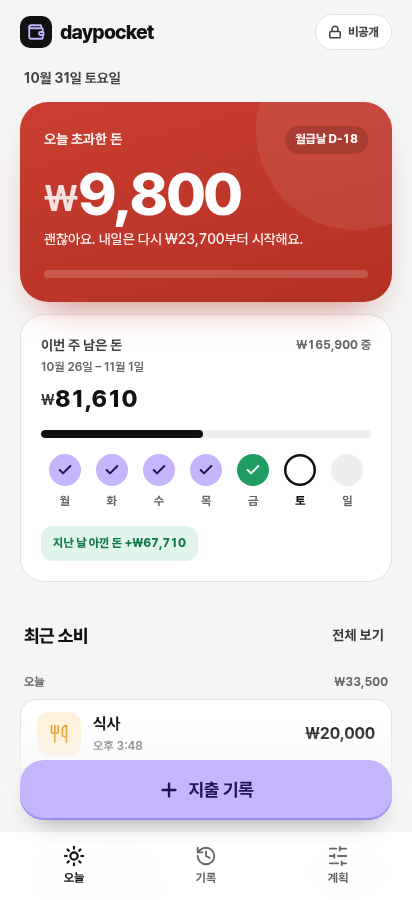 | 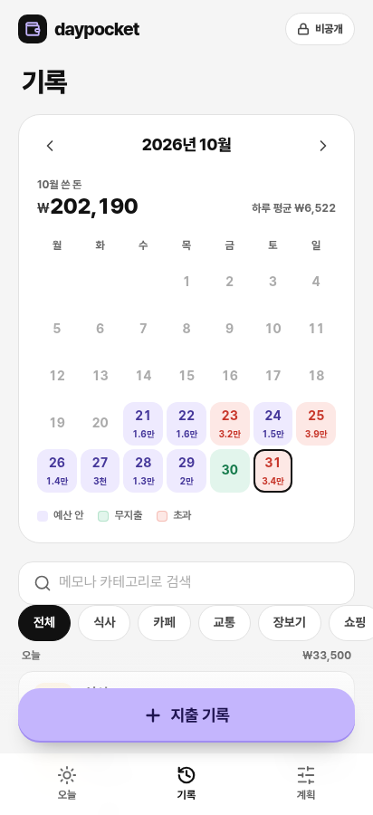 |
| K | 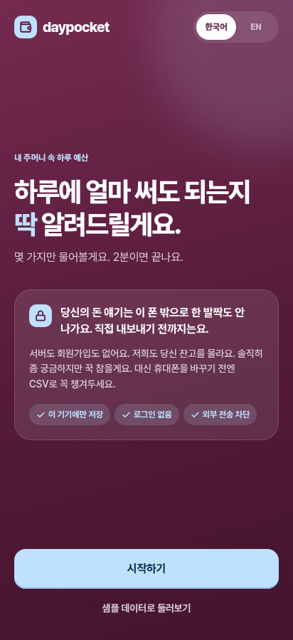 | 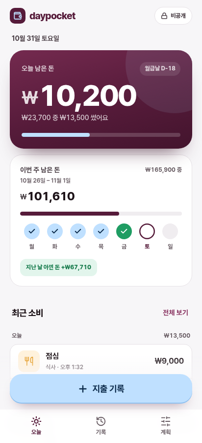 | 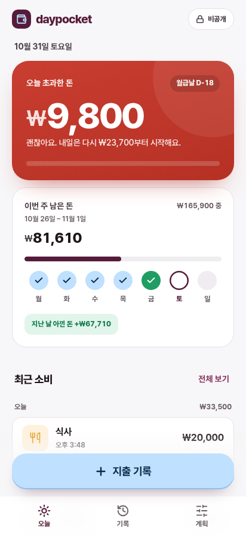 | 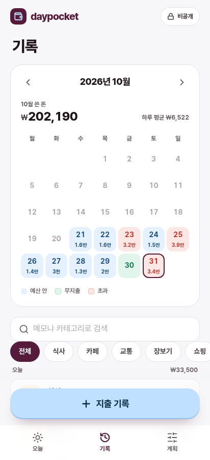 |
| L | 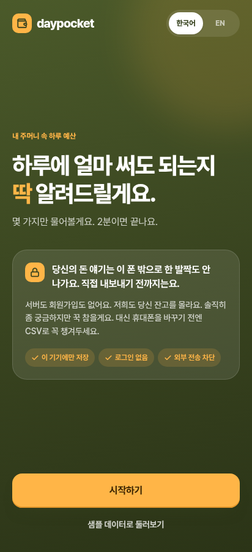 | 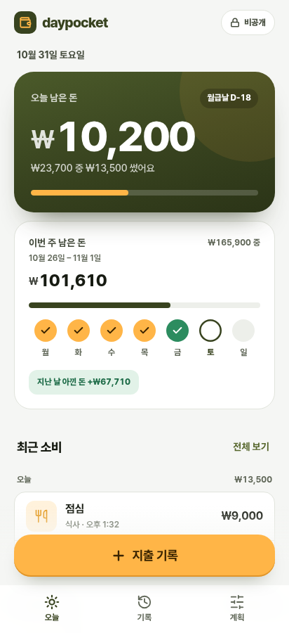 | 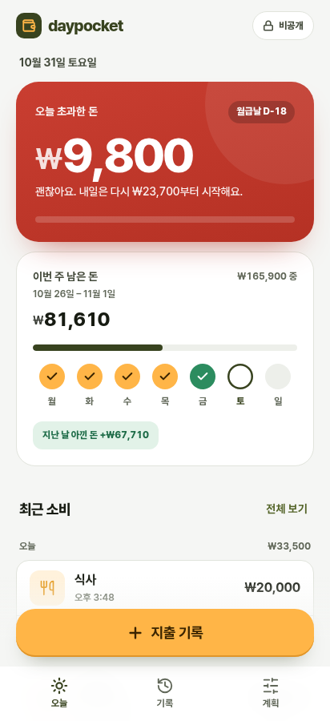 | 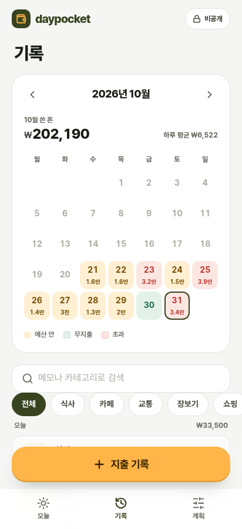 |

---

## 참고: 이전 시안
비교용으로 남겨 두었습니다. 아래 캡처는 초과 카드 색을 통일하기 전에 찍은 것이고, 링크로 열면 통일된 색으로 보입니다.

| 시안 | 링크 |
|---|---|
| A. 미드나잇 시트론 | https://smhan-dev.github.io/household-ledger-app/prototype/?theme=midnight |
| B. 샌드 & 딥틸 | https://smhan-dev.github.io/household-ledger-app/prototype/?theme=teal |
| C. 플럼 & 버터 | https://smhan-dev.github.io/household-ledger-app/prototype/?theme=plum |
| D. 클리어 블루 & 아쿠아 | https://smhan-dev.github.io/household-ledger-app/prototype/?theme=clear |
| E. 윈터 파인 & 샴페인 | https://smhan-dev.github.io/household-ledger-app/prototype/?theme=pine |
| F. 모노 (흰 키) | https://smhan-dev.github.io/household-ledger-app/prototype/?theme=mono |
| G. 플럼 & 라임 | https://smhan-dev.github.io/household-ledger-app/prototype/?theme=plumlime |

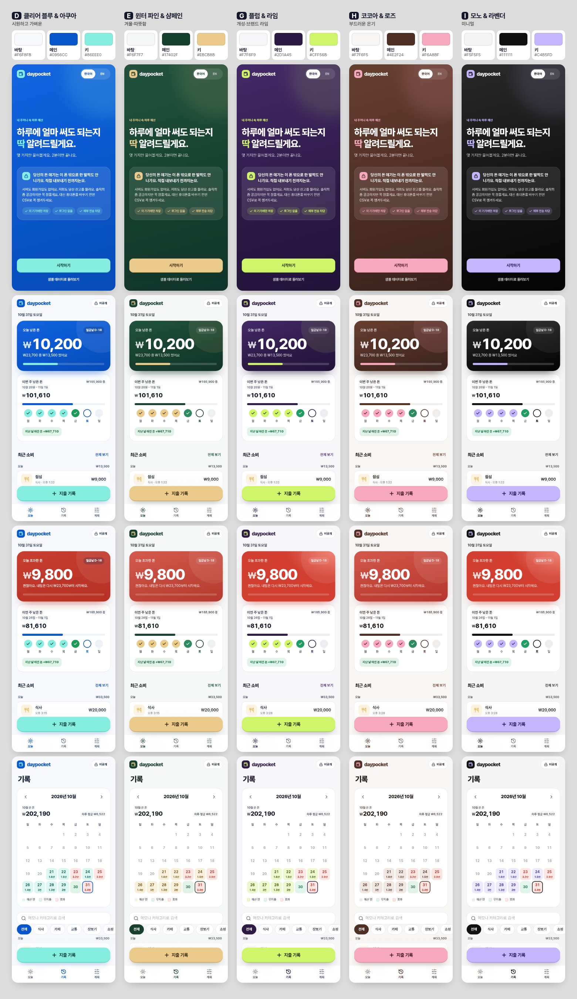

## 정한 뒤에 할 일
고른 시안의 `themes/*.css` 값을 `styles.css`의 `:root`와 `DESIGN.md` 2장에 옮기고, `themes/` 폴더와 `theme.js`는 지웁니다. 여러 개를 앱 안의 테마 선택 기능으로 남기는 것도 가능합니다.

`theme.js`는 목록에 있는 이름만 불러오고, 그 밖의 값(`../x`, `__proto__` 등)은 무시하는 것을 확인했습니다.
