# 색 조합 시안

아직 하나로 정하지 않은 후보들입니다. 기본 화면(`styles.css`)은 바꾸지 않았고, 각 시안은 `themes/` 폴더의 CSS가 색 기준값(토큰)만 덮어씁니다.

## 바로 눌러보기
주소 끝에 `?theme=`을 붙이면 실제 앱이 그 색으로 열립니다. "샘플 데이터로 둘러보기"를 누르면 오늘·기록·계획 화면까지 볼 수 있습니다.

| 시안 | 링크 |
|---|---|
| 현재: 네이비 & 라임 | https://smhan-dev.github.io/household-ledger-app/prototype/ |
| A. 미드나잇 시트론 | https://smhan-dev.github.io/household-ledger-app/prototype/?theme=midnight |
| B. 샌드 & 딥틸 | https://smhan-dev.github.io/household-ledger-app/prototype/?theme=teal |
| C. 플럼 & 버터 | https://smhan-dev.github.io/household-ledger-app/prototype/?theme=plum |

## 한눈에 비교
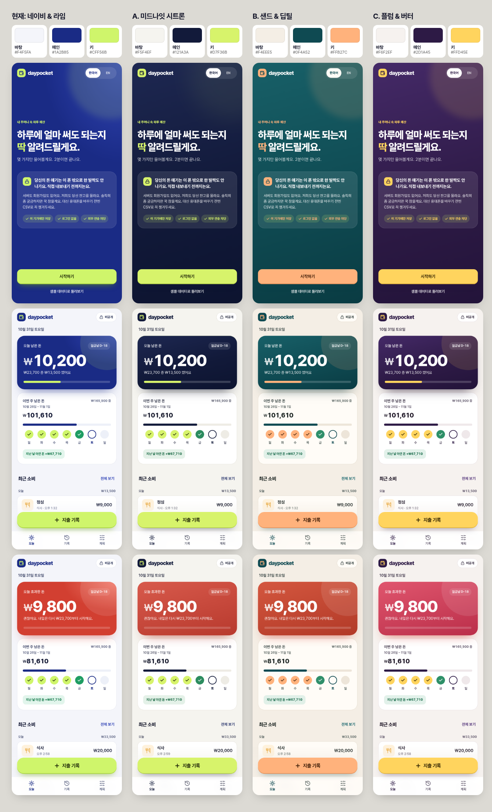

| | 바탕 | 메인 | 키 | 느낌 |
|---|---|---|---|---|
| 현재 | `#F4F5FA` 푸른 회색 | `#1A2B85` 로열 블루 | `#CFF56B` 형광 라임 | 스포티한 핀테크 |
| A. 미드나잇 시트론 | `#F5F4EF` 아이보리 | `#121A3A` 먹색에 가까운 남색 | `#D7F36B` 시트론 | 프라이빗 뱅크 |
| B. 샌드 & 딥틸 | `#F4EEE5` 모래색 | `#0F4A52` 깊은 청록 | `#FFB27C` 살구 | 차분하고 따뜻한 가계부 노트 |
| C. 플럼 & 버터 | `#F6F2EF` 따뜻한 흰색 | `#2D1A45` 짙은 자두색 | `#FFD45E` 버터 노랑 | 개성 있고 기억에 남는 |

## 시안별 설명

### A. 미드나잇 시트론
지금 조합을 그대로 두고 고급스럽게 다듬은 버전입니다.
1. 메인 색의 채도를 낮췄습니다. 쨍한 로열 블루를 먹색에 가까운 남색으로 바꿨습니다.
2. 바탕을 푸른 회색에서 아이보리로 바꾸고, 회색 글자도 따뜻한 회색으로 맞췄습니다.
3. 라임 버튼 아래의 라임색 빛 번짐을 남색 그림자로 바꿨습니다.
4. 카드 오른쪽 위의 큰 원 장식을 없애고, 카드 위쪽 가장자리에 얇은 라임 선만 남겼습니다.

### B. 샌드 & 딥틸
- 장점: 차분하고 따뜻해서 돈 이야기를 부드럽게 전달합니다.
- 약점: 키와 메인의 대비가 5.6:1로 가장 낮습니다. 살구색이 초과를 뜻하는 빨강과 같은 따뜻한 계열이라 "예산 안/초과" 구분이 약해지고, 살구가 주의 표시처럼 읽힐 수 있습니다.

### C. 플럼 & 버터
- 장점: 파랑·초록 일색인 금융 앱 사이에서 가장 눈에 띕니다.
- 약점: 노랑이 경고처럼 보일 수 있고, 금융 앱보다 생활 앱 분위기에 가깝습니다. 초과 화면은 빨강보다 분홍에 가깝습니다.

## 글자 대비 (4.5:1 이상이면 작은 글자도 읽기 충분)
| | 메인 위 흰 글자 | 메인 위 키 색 | 키 버튼 위 글자 | 바탕 위 캡션 | 바탕 위 링크 | 흰 바탕 위 초과 |
|---|---|---|---|---|---|---|
| 현재 | 12.2 | 9.8 | 12.7 | 4.8 | 7.1 | 5.3 |
| A | 17.0 | 13.7 | 13.6 | 5.2 | 9.8 | 5.9 |
| B | 9.9 | 5.6 | 8.9 | 4.9 | 5.5 | 6.3 |
| C | 15.6 | 11.0 | 11.1 | 5.4 | 8.4 | 6.1 |

## 화면별 캡처
| | 첫 화면 | 오늘 | 예산 초과 | 기록 |
|---|---|---|---|---|
| 현재 | 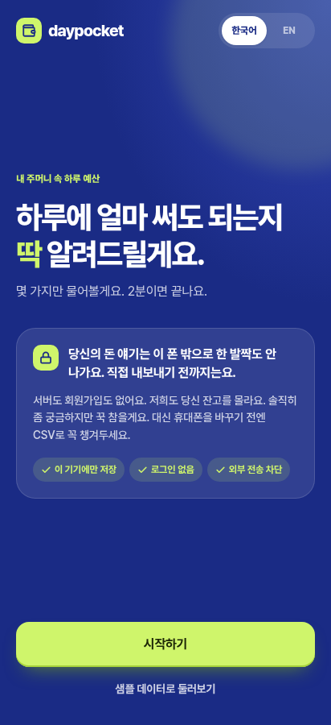 | 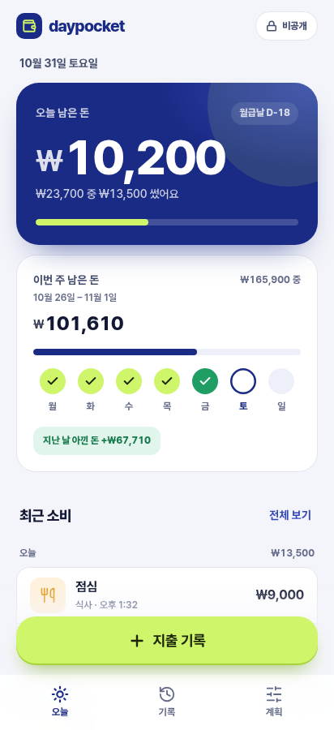 | 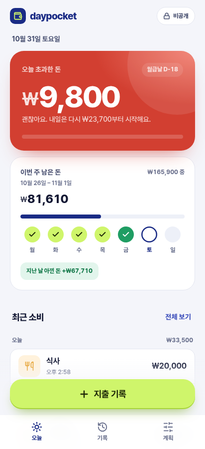 | 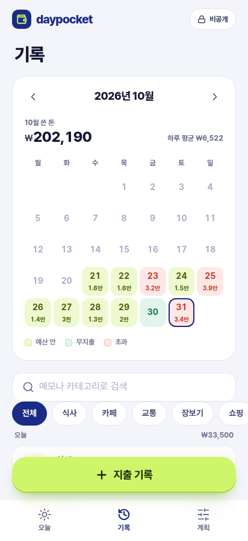 |
| A | 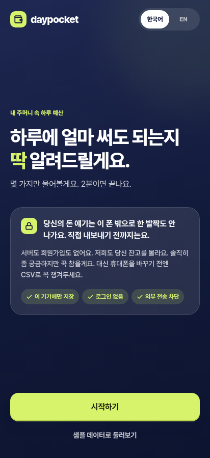 | 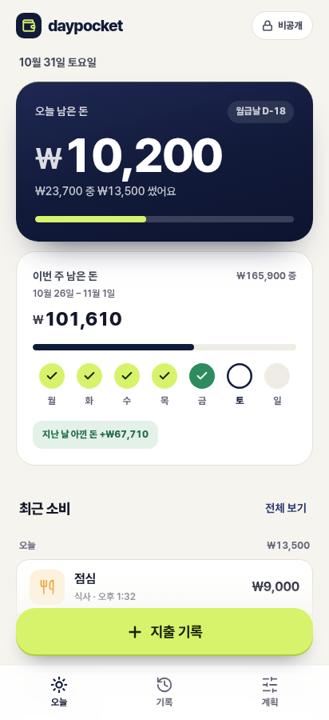 | 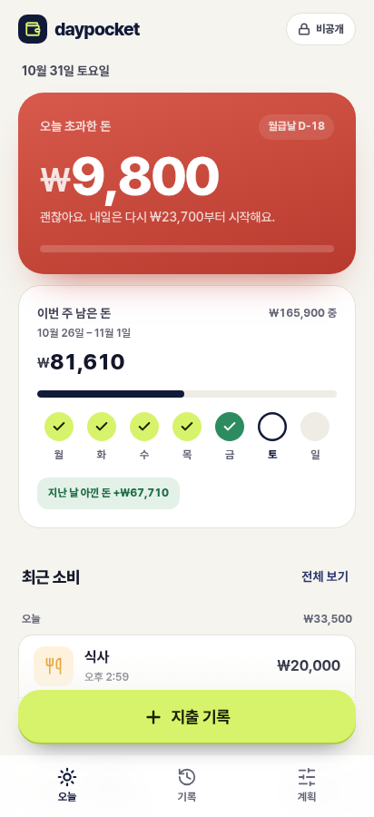 | 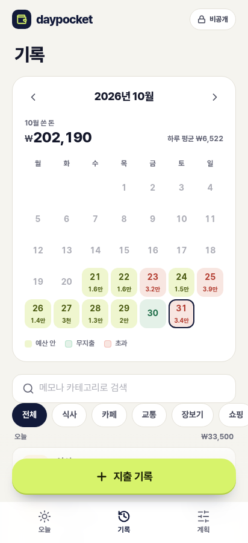 |
| B | 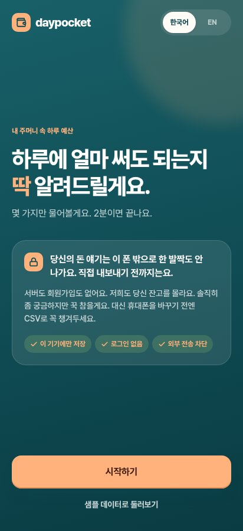 | 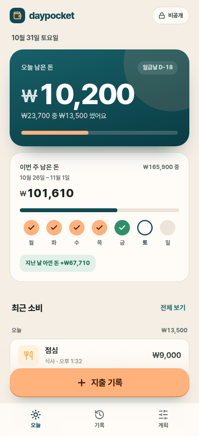 | 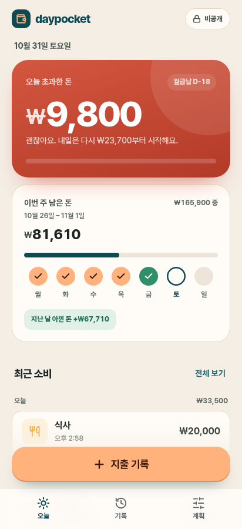 | 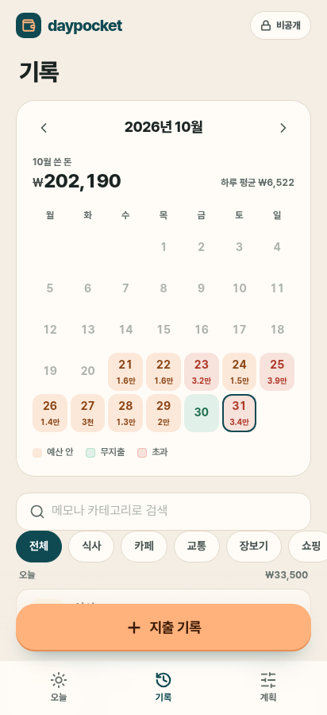 |
| C | 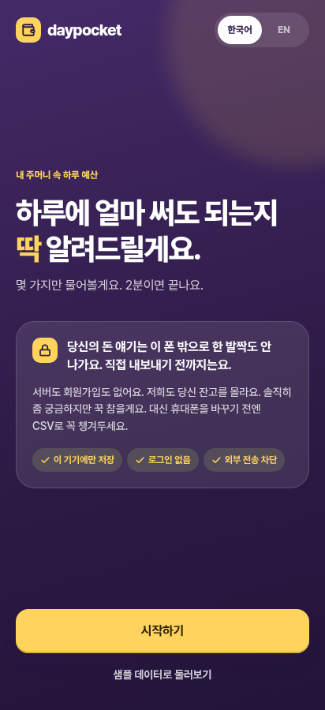 | 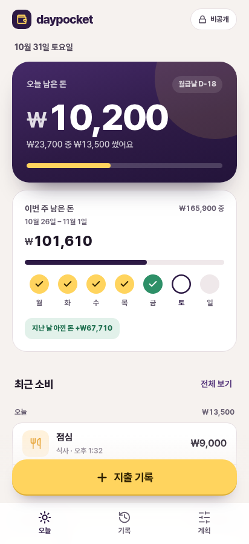 | 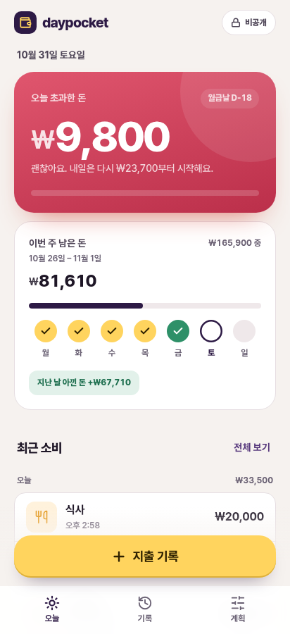 | 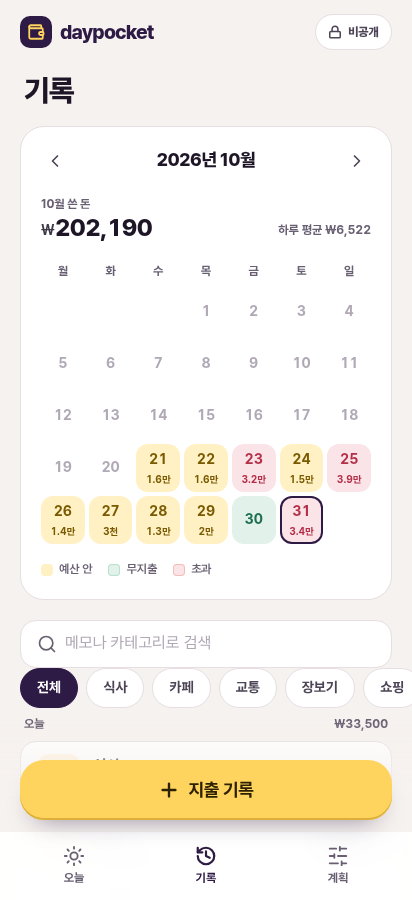 |

## 정한 뒤에 할 일
고른 시안의 `themes/*.css` 값을 `styles.css`의 `:root`와 `DESIGN.md` 2장에 옮기고, `themes/` 폴더와 `theme.js`는 지웁니다. 섞어서 쓰는 것(예: A 바탕 + C 키 색)도 같은 방식으로 합칩니다.

`theme.js`는 목록에 있는 이름(`midnight`, `teal`, `plum`)만 불러옵니다. 그 밖의 값(`../x`, `__proto__` 등)은 무시하는 것을 확인했습니다.
