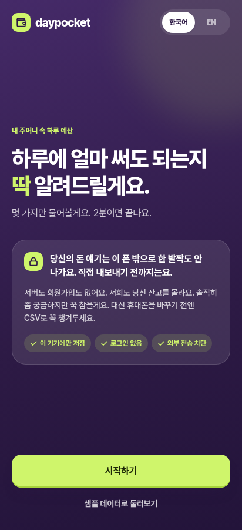
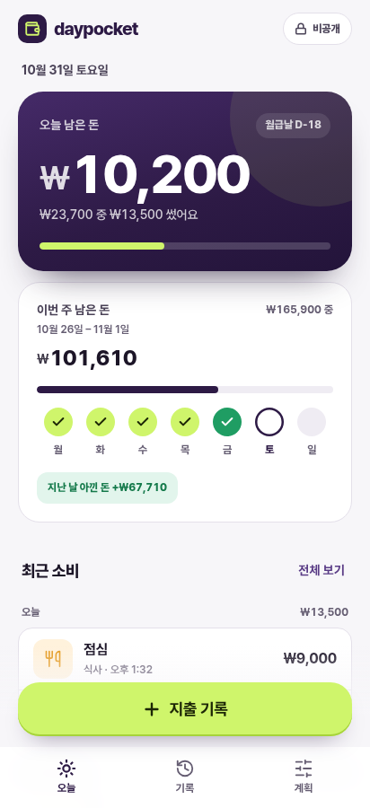
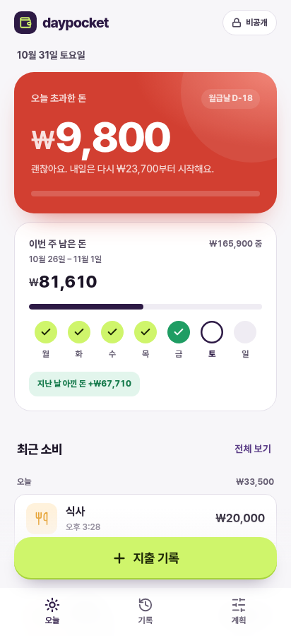
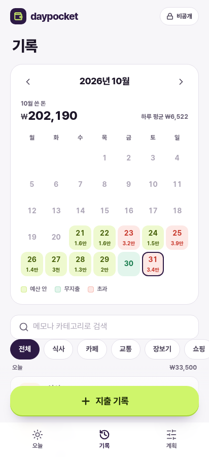

# 색 조합 시안

기본 화면(`styles.css`)은 바꾸지 않았고, 각 시안은 `themes/` 폴더의 CSS가 색 기준값(토큰)만 덮어씁니다. 주소 끝에 `?theme=이름`을 붙이면 실제 앱이 그 색으로 열립니다. "샘플 데이터로 둘러보기"를 누르면 오늘·기록·계획 화면까지 볼 수 있습니다.

## 추천 5개

| | 이름 | 바탕 / 메인 / 키 | 맡는 자리 | 링크 |
|---|---|---|---|---|
| D | 클리어 블루 & 아쿠아 | `#F6F8FB` / `#0956CC` / `#86EEE0` | 차갑고 가벼운 | https://smhan-dev.github.io/household-ledger-app/prototype/?theme=clear |
| E | 윈터 파인 & 샴페인 | `#F6F7F7` / `#17402F` / `#EBCB8B` | 겨울, 차분한 온기 | https://smhan-dev.github.io/household-ledger-app/prototype/?theme=pine |
| G | 플럼 & 라임 (새로 만듦) | `#F7F6F9` / `#2D1A45` / `#CFF56B` | 개성, 처음 라임 계승 | https://smhan-dev.github.io/household-ledger-app/prototype/?theme=plumlime |
| H | 코코아 & 로즈 (새로 만듦) | `#F7F6F5` / `#4E2F24` / `#F6A8BF` | 따뜻한 메인 색 | https://smhan-dev.github.io/household-ledger-app/prototype/?theme=cocoa |
| I | 모노 & 라벤더 (새로 만듦) | `#F5F5F5` / `#111111` / `#C4B5FD` | 미니멀 | https://smhan-dev.github.io/household-ledger-app/prototype/?theme=monolav |

### 겹치는지 어떻게 쟀나
색을 사람 눈에 가까운 OKLCH 방식으로 바꿔서 색상 각도(빨강 0°, 노랑 약 90°, 초록 약 140°, 파랑 약 260°)를 비교했습니다. 각도 차이가 10° 안쪽이면 같은 색으로 보입니다.

**추천 5개 사이의 간격**
- 키 색: 로즈 0°, 샴페인 84°, 라임 123°, 아쿠아 184°, 라벤더 294°. 가장 가까운 쌍이 E와 G로 39° 떨어져 있습니다.
- 메인 색: 코코아 40°, 소나무 163°, 코발트 260°, 플럼 302°, 검정(무채색). 가장 가까운 쌍이 D와 G로 42° 떨어져 있습니다.
- 한 시안 안에서도 바탕(밝기 97~98), 카드(100), 메인(18~49), 키(77~92)의 밝기가 서로 겹치지 않습니다.

### 걸러낸 시안과 이유
| 시안 | 겹친 곳 | 처리 |
|---|---|---|
| 현재 vs A | 메인 2°, 키 4° 차이. 사실상 같은 조합 | 둘 다 뺌. 라임 키는 G로 옮김 |
| C 플럼 & 버터 | 키(버터)가 E의 샴페인과 5° 차이 | 플럼은 살리고 키를 라임으로 바꿔 G로 만듦 |
| B 샌드 & 딥틸 | E와 구조가 같음(짙은 청록·초록 메인 + 따뜻한 키). 키/메인 대비도 5.6으로 가장 낮음 | 뺌 |
| F 모노 | 키가 흰색이라 밝은 화면에서 버튼이 검정(=메인)이 됨. 메인과 키가 같은 층으로 겹침 | 라벤더 키를 하나 더해 I로 만듦 |

### 새로 채운 영역
- **따뜻한 메인 색(H)**: 기존 일곱 개의 메인은 모두 파랑·초록·보라·무채색이었고, 갈색·주황 같은 따뜻한 메인이 없었습니다. Pantone이 2025년 올해의 색으로 갈색인 [Mocha Mousse](https://www.pantone.com/na/en-us/color-of-the-year/2025)를 골랐을 만큼 갈색은 지금 친숙한 색이라 코코아를 메인으로 썼습니다.
- **바탕**: Pantone 2026 올해의 색은 흰색인 [Cloud Dancer](https://www.pantone.com/articles/press-releases/pantone-announces-color-of-the-year-2026-cloud-dancer)입니다. 다섯 시안 모두 바탕을 거의 흰색으로 두되, 아이보리처럼 노란 기가 도는 흰색은 피했습니다.

### 추천 5개의 주의점
- **D**: 토스처럼 파랑을 대표색으로 쓰는 금융 앱과 같은 계열이라([토스 디자인 시스템 정리](https://github.com/rohitg00/awesome-claude-design/blob/main/design-md/playful/toss.md)) 개성은 아쿠아 키가 맡아야 합니다.
- **E**: 메인(소나무)과 "무지출" 초록이 같은 계열입니다.
- **G**: 플럼(302°)과 라임(123°)은 색상환에서 정반대인 보색이라 키가 가장 강하게 튑니다. 대신 화면이 다른 시안보다 활기차 보입니다.
- **H**: 로즈(0°)가 초과 빨강(29°)과 가깝습니다. 그래서 달력의 "예산 안" 날짜는 분홍 대신 코코아 빛으로 칠했고, 주간 점은 로즈(체크)와 연한 빨강(X)으로 구분됩니다.
- **I**: 라벤더(294°)가 G의 플럼 메인(302°)과 같은 보라 계열입니다. 같은 시안 안에서는 겹치지 않지만, I와 G를 함께 둘 경우 "보라"가 두 번 나옵니다.

## 글자 대비 (4.5:1 이상이면 작은 글자도 읽기 충분)
| | 메인 위 흰 글자 | 메인 위 키 색 | 키 버튼 위 글자 | 바탕 위 캡션 | 바탕 위 링크 | 흰 바탕 위 초과 |
|---|---|---|---|---|---|---|
| D | 6.5 | 4.8 | 9.2 | 5.5 | 5.8 | 5.5 |
| E | 11.6 | 7.4 | 9.5 | 5.6 | 6.9 | 5.9 |
| G | 15.6 | 12.6 | 12.7 | 5.8 | 8.0 | 5.3 |
| H | 12.0 | 6.4 | 8.8 | 5.9 | 6.8 | 6.1 |
| I | 18.9 | 10.2 | 8.9 | 5.3 | 10.4 | 5.3 |

## 추천 5개 화면별 캡처
| | 첫 화면 | 오늘 | 예산 초과 | 기록 |
|---|---|---|---|---|
| D |  |  |  |  |
| E |  |  |  |  |
| G |  |  |  |  |
| H |  |  |  |  |
| I |  |  |  |  |

---

## 참고: 이전 시안 전체 (현재, A~F)
걸러낸 시안도 비교용으로 남겨 두었습니다.

| 시안 | 바탕 / 메인 / 키 | 링크 |
|---|---|---|
| 현재: 네이비 & 라임 | `#F4F5FA` / `#1A2B85` / `#CFF56B` | https://smhan-dev.github.io/household-ledger-app/prototype/ |
| A. 미드나잇 시트론 | `#F5F4EF` / `#121A3A` / `#D7F36B` | https://smhan-dev.github.io/household-ledger-app/prototype/?theme=midnight |
| B. 샌드 & 딥틸 | `#F4EEE5` / `#0F4A52` / `#FFB27C` | https://smhan-dev.github.io/household-ledger-app/prototype/?theme=teal |
| C. 플럼 & 버터 | `#F6F2EF` / `#2D1A45` / `#FFD45E` | https://smhan-dev.github.io/household-ledger-app/prototype/?theme=plum |
| F. 모노 | `#F5F5F5` / `#111111` / `#FFFFFF` | https://smhan-dev.github.io/household-ledger-app/prototype/?theme=mono |

| | 메인 위 흰 글자 | 메인 위 키 색 | 키 버튼 위 글자 | 바탕 위 캡션 | 바탕 위 링크 | 흰 바탕 위 초과 |
|---|---|---|---|---|---|---|
| 현재 | 12.2 | 9.8 | 12.7 | 4.8 | 7.1 | 5.3 |
| A | 17.0 | 13.7 | 13.6 | 5.2 | 9.8 | 5.9 |
| B | 9.9 | 5.6 | 8.9 | 4.9 | 5.5 | 6.3 |
| C | 15.6 | 11.0 | 11.1 | 5.4 | 8.4 | 6.1 |
| F | 18.9 | 18.9 | 18.9 | 5.3 | 10.4 | 5.3 |

| | 첫 화면 | 오늘 | 예산 초과 | 기록 |
|---|---|---|---|---|
| 현재 |  |  |  |  |
| A |  |  |  |  |
| B |  |  |  |  |
| C |  |  |  |  |
| F |  |  |  |  |

## 정한 뒤에 할 일
고른 시안의 `themes/*.css` 값을 `styles.css`의 `:root`와 `DESIGN.md` 2장에 옮기고, `themes/` 폴더와 `theme.js`는 지웁니다. 여러 개를 앱 안의 테마 선택 기능으로 남기는 것도 가능합니다.

`theme.js`는 목록에 있는 이름만 불러오고, 그 밖의 값(`../x`, `__proto__` 등)은 무시하는 것을 확인했습니다.
