# 색 조합 시안

아직 하나로 정하지 않은 후보들입니다. 기본 화면(`styles.css`)은 바꾸지 않았고, 각 시안은 `themes/` 폴더의 CSS가 색 기준값(토큰)만 덮어씁니다.

## 바로 눌러보기
주소 끝에 `?theme=`을 붙이면 실제 앱이 그 색으로 열립니다. "샘플 데이터로 둘러보기"를 누르면 오늘·기록·계획 화면까지 볼 수 있습니다.

| 시안 | 링크 |
|---|---|
| 현재: 네이비 & 라임 | https://smhan-dev.github.io/household-ledger-app/prototype/ |
| A. 미드나잇 시트론 | https://smhan-dev.github.io/household-ledger-app/prototype/?theme=midnight |
| B. 샌드 & 딥틸 | https://smhan-dev.github.io/household-ledger-app/prototype/?theme=teal |
| C. 플럼 & 버터 | https://smhan-dev.github.io/household-ledger-app/prototype/?theme=plum |
| **D. 클리어 블루 & 아쿠아** (새로 추가) | https://smhan-dev.github.io/household-ledger-app/prototype/?theme=clear |
| **E. 윈터 파인 & 샴페인** (새로 추가) | https://smhan-dev.github.io/household-ledger-app/prototype/?theme=pine |
| **F. 모노 (블랙 & 화이트)** (새로 추가) | https://smhan-dev.github.io/household-ledger-app/prototype/?theme=mono |

## 한눈에 비교

| | 바탕 | 메인 | 키 | 느낌 |
|---|---|---|---|---|
| 현재 | `#F4F5FA` 푸른 회색 | `#1A2B85` 로열 블루 | `#CFF56B` 형광 라임 | 스포티한 핀테크 |
| A. 미드나잇 시트론 | `#F5F4EF` 아이보리 | `#121A3A` 먹색에 가까운 남색 | `#D7F36B` 시트론 | 프라이빗 뱅크 |
| B. 샌드 & 딥틸 | `#F4EEE5` 모래색 | `#0F4A52` 깊은 청록 | `#FFB27C` 살구 | 차분하고 따뜻한 가계부 노트 |
| C. 플럼 & 버터 | `#F6F2EF` 따뜻한 흰색 | `#2D1A45` 짙은 자두색 | `#FFD45E` 버터 노랑 | 개성 있고 기억에 남는 |
| D. 클리어 블루 & 아쿠아 | `#F6F8FB` 차가운 흰색 | `#0956CC` 맑은 코발트 | `#86EEE0` 아쿠아 | 시원하고 가벼운 |
| E. 윈터 파인 & 샴페인 | `#F6F7F7` 눈 같은 흰색 | `#17402F` 짙은 소나무색 | `#EBCB8B` 샴페인 골드 | 겨울에 어울리는 따뜻함, 바탕은 깔끔 |
| F. 모노 | `#F5F5F5` 밝은 회색 | `#111111` 검정 | `#FFFFFF` 흰색 | 미니멀, 숫자만 남는 |

## 시안별 설명

### A. 미드나잇 시트론
지금 조합을 그대로 두고 고급스럽게 다듬은 버전입니다.
1. 메인 색의 채도를 낮췄습니다. 쨍한 로열 블루를 먹색에 가까운 남색으로 바꿨습니다.
2. 바탕을 푸른 회색에서 아이보리로 바꾸고, 회색 글자도 따뜻한 회색으로 맞췄습니다.
3. 라임 버튼 아래의 라임색 빛 번짐을 남색 그림자로 바꿨습니다.
4. 카드 오른쪽 위의 큰 원 장식을 없애고, 카드 위쪽 가장자리에 얇은 라임 선만 남겼습니다.

### B. 샌드 & 딥틸
- 장점: 차분하고 따뜻해서 돈 이야기를 부드럽게 전달합니다.
- 약점: 키와 메인의 대비가 5.6:1로 가장 낮습니다. 살구색이 초과를 뜻하는 빨강과 같은 따뜻한 계열이라 "예산 안/초과" 구분이 약해지고, 살구가 주의 표시처럼 읽힐 수 있습니다.

### C. 플럼 & 버터
- 장점: 파랑·초록 일색인 금융 앱 사이에서 가장 눈에 띕니다.
- 약점: 노랑이 경고처럼 보일 수 있고, 금융 앱보다 생활 앱 분위기에 가깝습니다. 초과 화면은 빨강보다 분홍에 가깝습니다.

### D. 클리어 블루 & 아쿠아
- 장점: 바탕을 거의 흰색으로 두고 메인을 밝은 코발트로 올려서, 넷 중 가장 가볍고 시원합니다. 아쿠아 버튼이 화면을 깨끗하게 마무리합니다.
- 조정한 점: 파랑이 밝아서 카드 안 보조 글자를 78% 불투명도로 두면 대비가 3.4:1로 떨어집니다. 그래서 보조 글자를 94%로 올렸고, D-day 배지는 바탕을 밝게 하지 않고 살짝 어둡게 바꿨습니다.
- 약점: 파란 금융 앱이 많아서 개성은 약합니다. 큰 숫자와 보조 글자의 밝기 차이가 다른 시안보다 작습니다.

### E. 윈터 파인 & 샴페인
- 장점: 소나무색과 샴페인 골드가 겨울, 연말 분위기를 내면서도 바탕이 눈 같은 흰색이라 답답하지 않습니다. 메인 위 흰 글자 대비가 11.6:1로 아주 선명합니다.
- 약점: 메인 색과 "무지출"을 뜻하는 초록이 같은 계열이라 초록의 의미가 조금 겹칩니다. 골드가 C의 버터 노랑과 같은 계열이지만, 더 차분하고 덜 노랗습니다.

### F. 모노 (블랙 & 화이트)
- 장점: 숫자만 또렷하게 남는 가장 미니멀한 조합입니다. 색을 쓰는 곳은 무지출(초록), 초과(빨강), 카테고리 아이콘뿐이라 상태가 한눈에 보입니다.
- 조정한 점: 키 색이 흰색이어서 밝은 화면의 "지출 기록", "저장" 버튼은 검정으로 바꿨습니다. 강조 글자("딱")는 색 대신 밑줄이나 회색 형광펜으로 표시하고, 주간 점의 "예산 안"은 검정 동그라미로 바꿨습니다.
- 약점: 오늘 카드와 지출 기록 버튼이 둘 다 검정이라 화면 위아래 무게가 비슷합니다. 카테고리 아이콘 색까지 회색으로 바꾸면 더 엄격한 흑백이 되지만, 그러면 목록에서 카테고리를 구분하기 어려워집니다.

## 글자 대비 (4.5:1 이상이면 작은 글자도 읽기 충분)
| | 메인 위 흰 글자 | 메인 위 키 색 | 키 버튼 위 글자 | 바탕 위 캡션 | 바탕 위 링크 | 흰 바탕 위 초과 |
|---|---|---|---|---|---|---|
| 현재 | 12.2 | 9.8 | 12.7 | 4.8 | 7.1 | 5.3 |
| A | 17.0 | 13.7 | 13.6 | 5.2 | 9.8 | 5.9 |
| B | 9.9 | 5.6 | 8.9 | 4.9 | 5.5 | 6.3 |
| C | 15.6 | 11.0 | 11.1 | 5.4 | 8.4 | 6.1 |
| D | 6.5 | 4.8 | 9.2 | 5.5 | 5.8 | 5.5 |
| E | 11.6 | 7.4 | 9.5 | 5.6 | 6.9 | 5.9 |
| F | 18.9 | 18.9 | 18.9 | 5.3 | 10.4 | 5.3 |

D는 카드 밝은 쪽의 보조 글자 5.0, D-day 배지 6.9도 따로 확인했습니다. F의 "키 버튼 위 글자"는 밝은 화면의 검정 버튼 위 흰 글자 값입니다.

## 화면별 캡처
| | 첫 화면 | 오늘 | 예산 초과 | 기록 |
|---|---|---|---|---|
| 현재 |  |  |  |  |
| A |  |  |  |  |
| B |  |  |  |  |
| C |  |  |  |  |
| D | 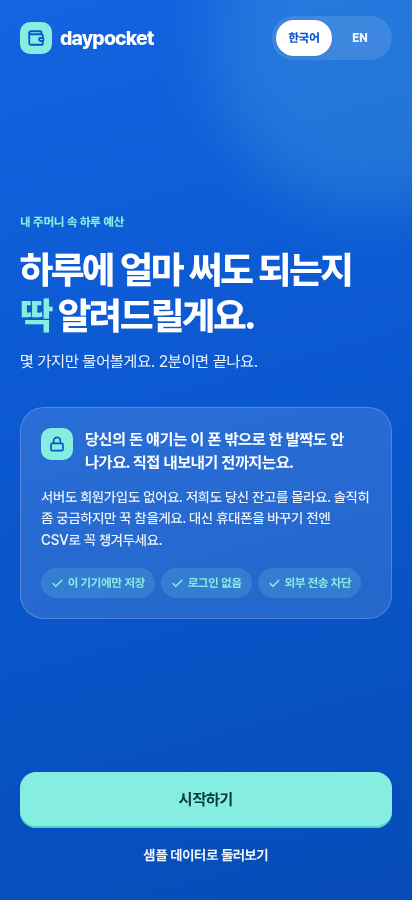 | 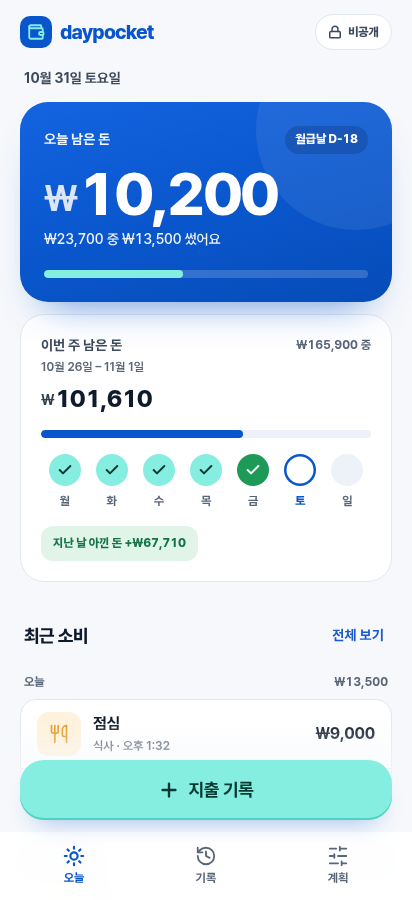 | 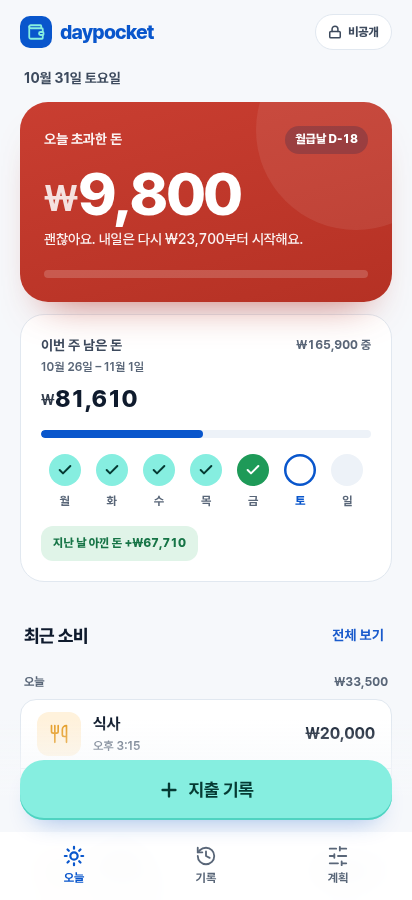 | 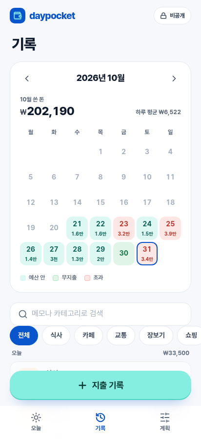 |
| E | 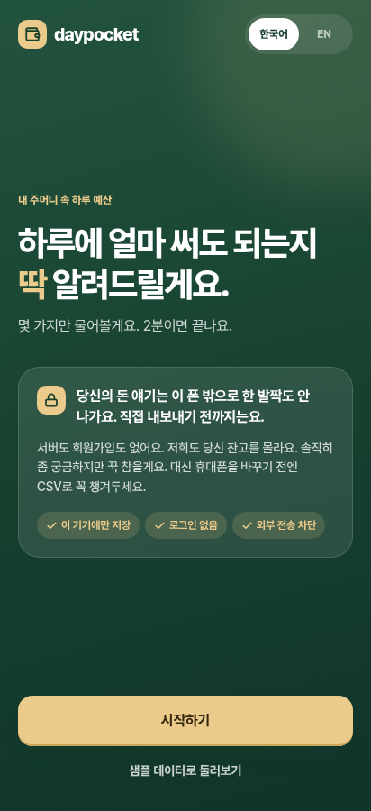 | 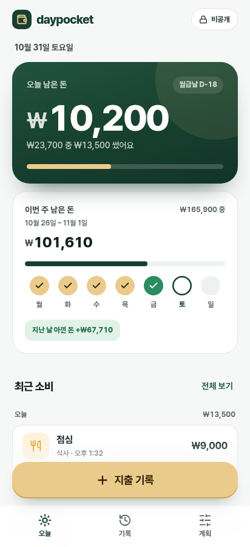 | 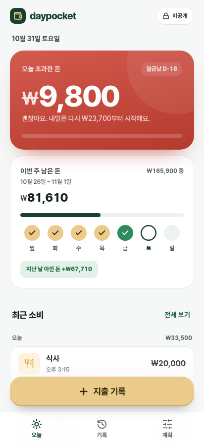 | 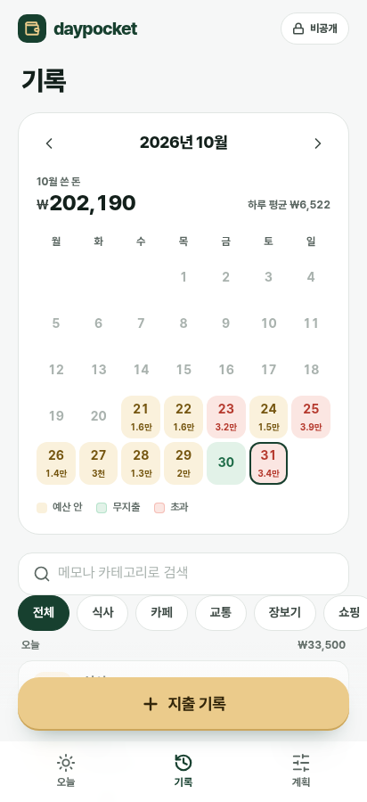 |
| F | 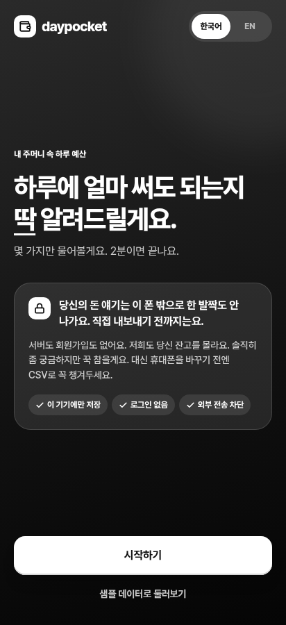 | 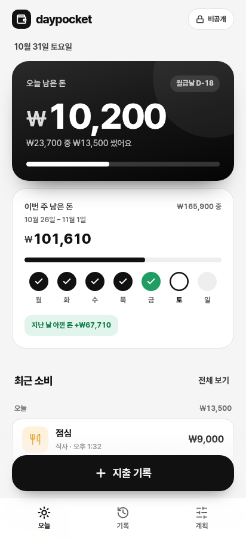 | 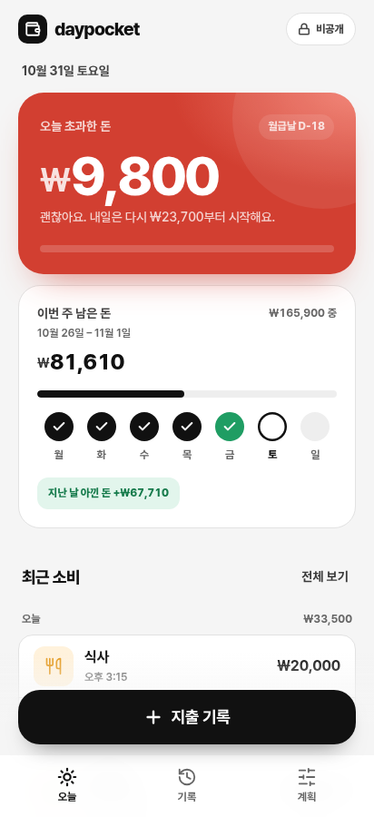 | 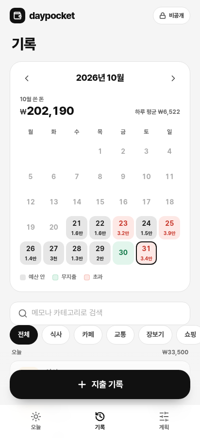 |

F는 버튼 색을 바꾼 곳이 있어서 지출 입력 창과 세팅 화면도 캡처했습니다.

| F 지출 입력 | F 세팅 첫 단계 |
|---|---|
| 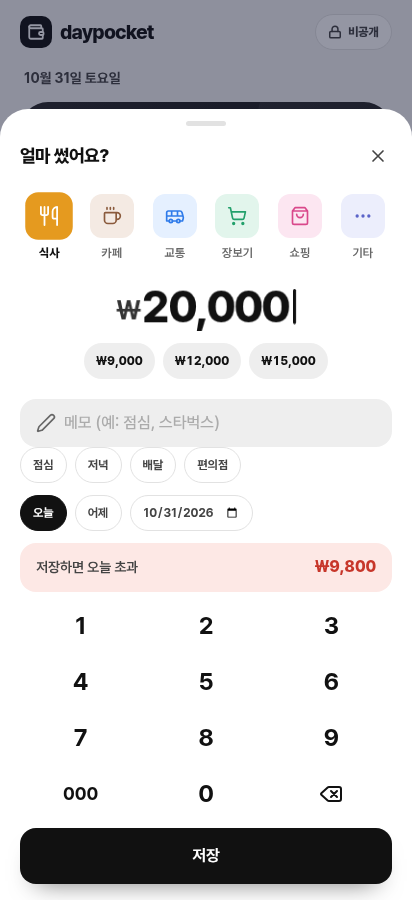 | 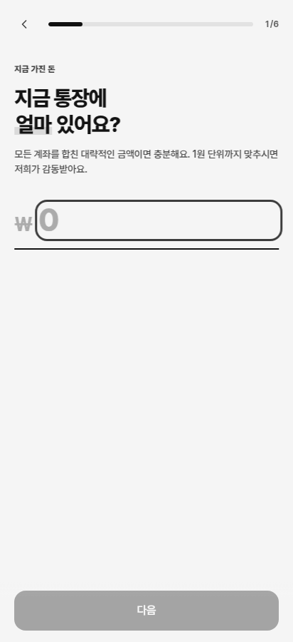 |

## 정한 뒤에 할 일
고른 시안의 `themes/*.css` 값을 `styles.css`의 `:root`와 `DESIGN.md` 2장에 옮기고, `themes/` 폴더와 `theme.js`는 지웁니다. 섞어서 쓰는 것(예: D 바탕 + E 키 색)도 같은 방식으로 합칩니다.

`theme.js`는 목록에 있는 이름(`midnight`, `teal`, `plum`, `clear`, `pine`, `mono`)만 불러옵니다. 그 밖의 값(`../x`, `__proto__` 등)은 무시하는 것을 확인했습니다.
