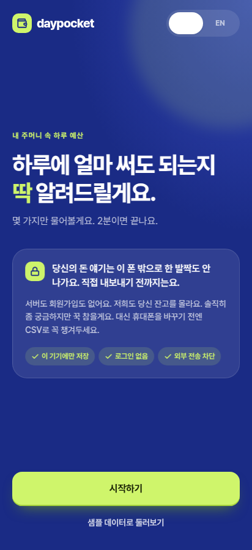
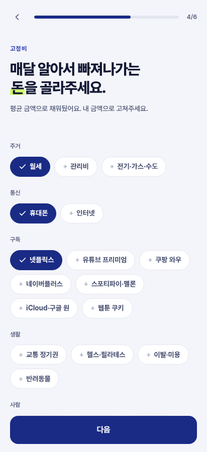
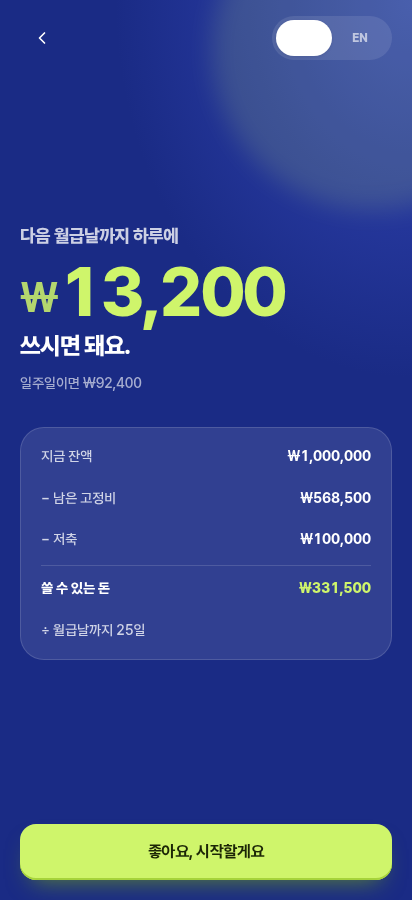
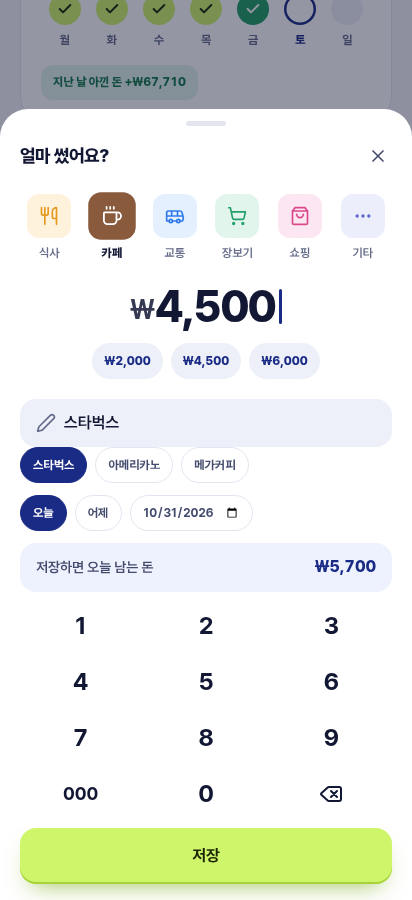
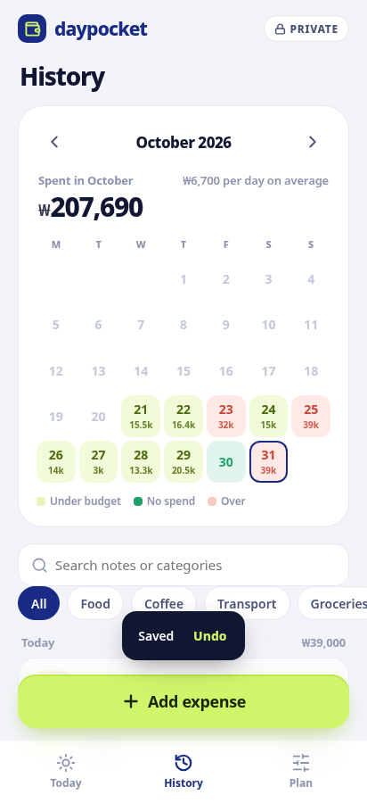
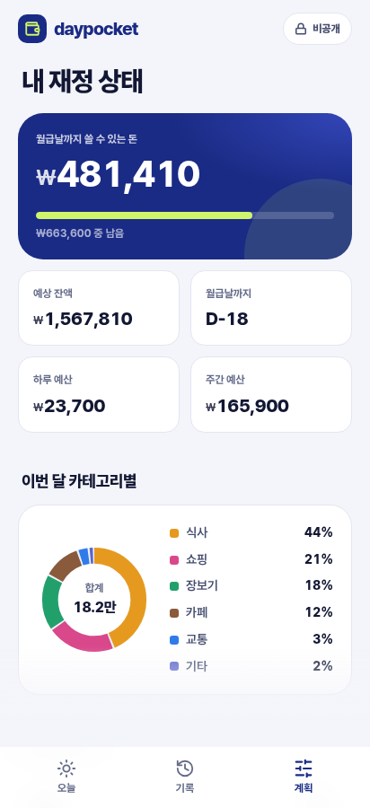

# daypocket 웹 프로토타입

화면 구성과 계산 방식을 확인하기 위한 클릭 프로토타입입니다. 빌드 과정 없이 `index.html`을 브라우저로 열면 동작합니다. 데이터는 브라우저 localStorage에만 저장되고, 페이지는 외부로 요청을 보낼 수 없게 막혀 있습니다. **실제 재정 정보 대신 "샘플 데이터로 둘러보기"를 쓰는 것을 권장합니다.**

## 화면
- **처음 세팅**: 잔액 → 월급·월급날 → 들어올 돈 → 고정비 → 빚 → 저축 → 하루 예산 결과
- **오늘**: 오늘 남은 돈, 월급날 D-day, 이번 주 남은 돈(월~일), 지출 입력 시트, 최근 소비
- **기록**: 월별 달력, 검색, 카테고리 필터
- **계획**: 재정 요약, 카테고리별 차트, 항목 수정 후 예산 재계산, CSV 내보내기, 전체 삭제
- 한국어 / English 전환

## 계산 규칙
- 하루 예산 = (잔액 + 월급날 전 들어올 돈 − 월급날 전 고정비 − 빚 상환 − 저축) ÷ 월급날까지 남은 일수, 100원 단위 내림
- 하루 예산은 매일 초기화되고, 아끼거나 초과한 금액은 주간 잔액에만 반영
- 주간 예산 = 하루 예산 × 7 (월요일 시작)

## 문서
- [`DESIGN.md`](DESIGN.md): 디자인 문법 (색, 글자, 간격, 모서리, 움직임, 문구, 컴포넌트)
- [`SECURITY.md`](SECURITY.md): 데이터 흐름, 보안 시험 결과, 실제 앱에서 확인할 것
- [`PALETTES.md`](PALETTES.md): 색 조합 최종 후보 5개(`?theme=navylime`, `cocoa`, `monolav`, `merlot`, `olive`)와 이전 시안 비교

## 파일
- `index.html`: 진입점, 외부 요청 차단 정책(CSP)
- `styles.css`: 디자인 토큰과 스타일
- `i18n.js`: 한/영 문구와 고정비·빚·수입 프리셋
- `app.js`: 화면 렌더링, 계산, 이벤트 처리
- `fonts/`: Pretendard 글꼴(SIL OFL 1.1)과 라이선스
- `theme.js`, `themes/`: 색 시안 전환 (확정 후 삭제 예정)
- `palettes/`: 색 시안 캡처와 비교 보드
- `screenshots/`: 시험 중 캡처한 화면

| 첫 화면 | 고정비 | 세팅 결과 | 오늘 |
|---|---|---|---|
|  |  |  |  |

| 지출 입력 | 기록 | 계획 |
|---|---|---|
|  |  |  |
