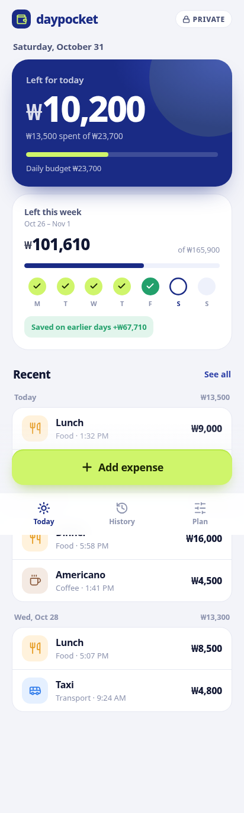
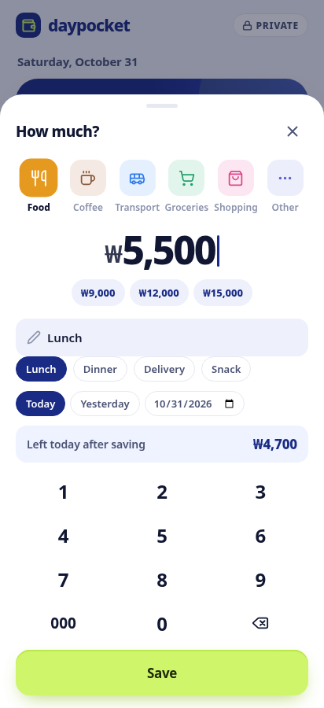
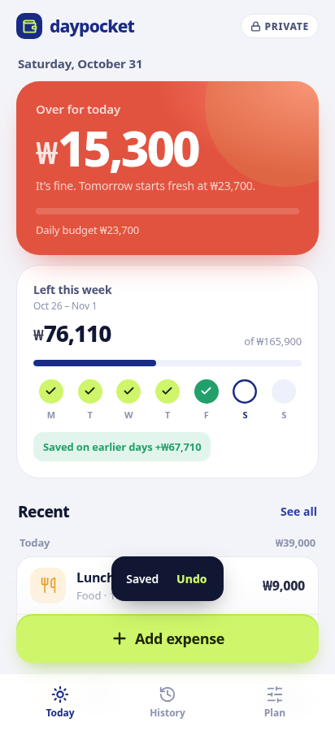
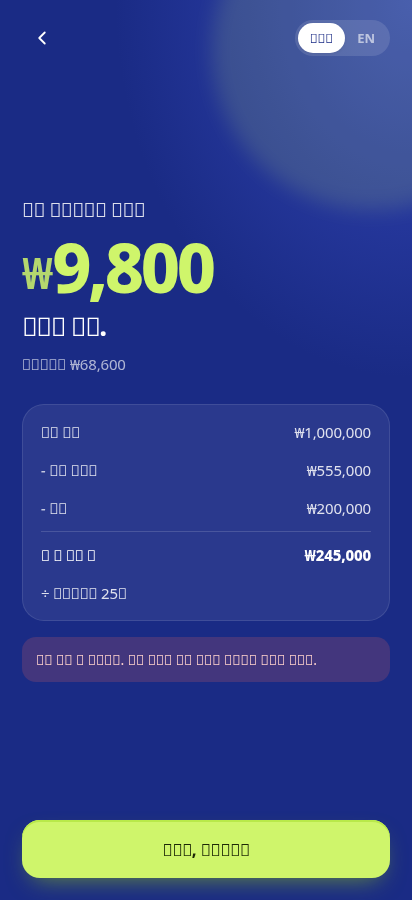

# daypocket 웹 프로토타입

화면 구성과 계산 방식을 확인하기 위한 클릭 프로토타입입니다. 빌드 과정 없이 `index.html`을 브라우저로 열면 동작합니다. 데이터는 브라우저 localStorage에만 저장됩니다.

## 화면
- **처음 세팅**: 잔액 → 월급·월급날 → 들어올 돈 → 고정비 → 빚 → 저축 → 하루 예산 결과
- **Today**: 오늘 남은 돈, 이번 주 남은 돈(월~일), 지출 입력 시트, 최근 소비
- **History**: 월별 달력, 검색, 카테고리 필터
- **Plan**: 재정 요약, 카테고리별 차트, 항목 수정 후 예산 재계산, CSV 내보내기
- 한국어 / English 전환

## 계산 규칙
- 하루 예산 = (잔액 + 월급날 전 들어올 돈 − 월급날 전 고정비 − 빚 상환 − 저축) ÷ 월급날까지 남은 일수, 100원 단위 내림
- 하루 예산은 매일 초기화되고, 아끼거나 초과한 금액은 주간 잔액에만 반영
- 주간 예산 = 하루 예산 × 7 (월요일 시작)

## 파일
- `index.html`: 진입점
- `styles.css`: 스타일
- `i18n.js`: 한/영 문구와 고정비·빚·수입 프리셋
- `app.js`: 화면 렌더링, 계산, 이벤트 처리
- `screenshots/`: 테스트 중 캡처한 화면

| 첫 화면 | Today | 지출 입력 | 예산 초과 |
|---|---|---|---|
|  |  |  |  |

| History | Plan | 세팅 결과 |
|---|---|---|
|  |  |  |
